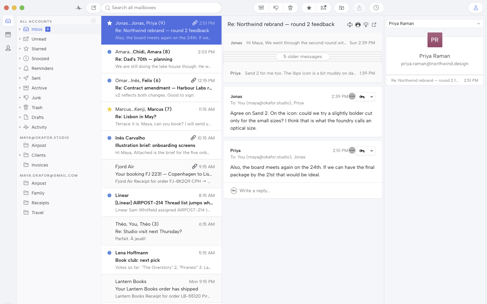

# Airpost

[](https://github.com/airpost-mail/airpost/actions/workflows/engine.yml)
[](https://github.com/airpost-mail/airpost/actions/workflows/desktop-test.yml)
[](LICENSE.md)
[](rust-toolchain.toml)


Airpost is a desktop email client for macOS and Linux, forked from Mailspring, with its sync
engine rewritten in Rust. It works with Gmail, Microsoft 365, Outlook.com and any
IMAP/SMTP server, and it needs no account or server of its own: download it, add a mail
account, and your mail syncs directly between your computer and your provider. On top of the
desktop app, the same engine can be driven from a terminal, by AI agents over MCP, and from a
browser through a web client you host yourself.

<picture>
  <source media="(prefers-color-scheme: dark)" srcset="assets/screenshots/main-dark.png">
  
</picture>

## Features

- **Mail, calendar and contacts.** Unified inbox, threads, labels and folders, search with
  `from:`, `in:`, `is:`, `has:attachment`, `before:`/`after:` and boolean operators.
  Calendars and contacts sync over CalDAV and CardDAV (Google contacts through the People
  API).
- **Local features that need no server.** Snooze, send later, send reminders, templates,
  mail rules, one-click unsubscribe, undo send, signatures.
- **Privacy defaults.** Remote images are blocked until you load them, tracking pixels from
  known trackers are stripped from incoming mail, contact photos from Gravatar are off, and
  mail whose reply-to address differs from the sender's gets a phishing warning.
- **Rust sync engine** (`airpost-engine`). One process holds all your accounts and serves the
  desktop, the CLI, the MCP server and the gateway over a local socket. It can keep running
  after the app quits, so scheduled sends still go out.
- **The `airpost` command.** Read, search, draft and send mail; archive, move, label, snooze
  and unsubscribe; mail rules, templates, signatures, contacts, calendar, tasks, logs and a
  live `watch`, with `--json` on everything. It also
  installs and manages Airpost's background services as launchd or systemd user units
  (`airpost engine|gateway|mcp-http install`).
- **MCP server for AI agents** (`airpost-mcp`). Over stdio for Claude Desktop, Claude Code and
  Codex (`airpost-mcp install`), or streamable HTTP with a bearer token. Three access levels
  (read; read and draft; read, draft and send), per-account and per-folder limits, and an
  audit log. Configured in Preferences > MCP. See the [MCP docs](https://docs.airpost.sh/agents/overview).
- **Web client and gateway.** `airpost-gateway` serves the web client (`apps/web`) and relays it
  to an engine, on your own computer or on a server. Browsers pair with a one-time code.
- **AI**, optional and off until you set it up: thread summaries, reply suggestions and
  inbox sorting, with your own key for an OpenAI-compatible or Anthropic API, or a local
  model through Ollama, LM Studio or llama.cpp.
- **Plugins and themes.** The plugin system from Mailspring, with built-in features and
  bundled plugins loaded the same way, six bundled themes, and service plugins that run as
  their own process next to the engine ([examples/service-plugin](examples/service-plugin)).
  Integrations for translation (LibreTranslate, DeepL) and grammar checking (LanguageTool)
  use your own servers or keys.

Read receipts, link tracking, thread sharing and settings sync between computers need an Airpost
server and aren't available yet; the desktop shows them as "Needs an Airpost server".

## Install

Airpost runs on macOS (Apple Silicon and Intel) and Linux (x86_64 and arm64). Windows isn't
supported.

The desktop app, which brings its own engine and the `airpost` command:

```sh
brew install --cask airpost-mail/tap/airpost
```

or the macOS zip or Linux .deb/.rpm from [airpost.sh/download](https://airpost.sh/download).
The macOS app isn't notarized by Apple yet, so the first time you open it macOS blocks it: open
System Settings > Privacy & Security and click Open Anyway.

The command-line programs on their own (`airpost`, `airpost-engine`, `airpost-mcp`,
`airpost-gateway` and the web client), for a server or a machine without the desktop:

```sh
curl -fsSL https://github.com/airpost-mail/airpost/releases/latest/download/install.sh | sh
```

or `brew install airpost-mail/tap/airpost`, the `airpost-cli` .deb/.rpm from the
[latest release](https://github.com/airpost-mail/airpost/releases/latest), or
`nix profile install github:airpost-mail/airpost`. The [install docs](https://docs.airpost.sh/install)
cover each one.

## Quick start

### Command line, without the desktop

```sh
airpost engine install            # the engine in the background, started at login
airpost account add you@example.com
airpost status
airpost search from:alice has:attachment
```

To give an AI agent your mail, pick one: `airpost-mcp install --client claude-code` (MCP, with the
access level and hidden folders you set in Airpost), or `airpost skill install` (the CLI with a skill;
full access, as you have at your terminal). The [MCP docs](https://docs.airpost.sh/agents/overview) have both.

For the web client on the same computer, `airpost gateway install` and `airpost gateway pair`. In
the desktop app these services are in Preferences > General.

### Self-hosted Airpost server

`deploy/server/` runs the engine headless with the gateway, the web client and a TLS proxy,
and optionally MCP over HTTP, from one image (`ghcr.io/airpost-mail/airpost-server`) and one
compose file:

```sh
git clone https://github.com/airpost-mail/airpost.git
cd airpost/deploy/server
cp .env.example .env            # AIRPOST_DOMAIN, AIRPOST_VERSION, COMPOSE_PROFILES
docker compose up -d
docker compose exec engine airpost account add you@example.com
docker compose exec gateway airpost-gateway pair
```

The server holds one person's mail for now. Setup, accounts, backups and upgrades are in
the [self-hosting docs](https://docs.airpost.sh/self-hosting/overview).

### From source

You need the Node version in `.node-version`, Rust (pinned by `rust-toolchain.toml`), Python 3
and a C/C++ toolchain.

```sh
git clone https://github.com/airpost-mail/airpost.git
cd airpost
make setup     # npm ci, Python deps, debug Rust builds
make desktop   # the app on a sandbox profile in .dev/profile
make mail      # optional: fake IMAP and SMTP accounts to test against
```

`make desktop` never touches your real profile. `make help` lists every target, and
[CONTRIBUTING.md](CONTRIBUTING.md) has the rest.

## Architecture

The engine is the only process that touches mail: it holds the credentials, the mail
database and search, and speaks JSON-RPC on a Unix socket that only the same user can reach.
The desktop, `airpost`, `airpost-mcp` and `airpost-gateway` are separate clients of that socket, and
the web client reaches it only through the gateway. The backend is a separate server for
metadata sync between devices and never holds mail credentials or content. launchd, systemd
or Docker supervise the processes; there is no orchestrator. More in
[docs/architecture.md](docs/architecture.md).

| Path | Contents |
|---|---|
| `apps/desktop/` | Electron client (TypeScript, React); see its README.md and CLAUDE.md |
| `apps/engine/` | Rust sync engine, `airpost-engine`, its black-box test harness and parser fuzz targets |
| `apps/cli/` | The `airpost` command and the agent skill it installs (`airpost skill install`) |
| `apps/mcp/` | The MCP server, `airpost-mcp` |
| `apps/gateway/` | `airpost-gateway`: serves the web client and relays it to an engine |
| `apps/web/` | Web client (Vite, React, shadcn/ui); runs against a gateway or an in-browser mock engine for development |
| `apps/backend/` | `airpost-backend`: users, device tokens and metadata sync; tracking and sharing not yet implemented |
| `crates/` | Rust libraries: IMAP, SMTP, MIME, storage, sync, tasks, CalDAV/CardDAV, the socket protocol, AI, secrets |
| `packages/` | TypeScript libraries shared by the apps: the engine client (`client`) and `email-dark` |
| `docs/` | Architecture docs; desktop docs (plugins, themes, localization) in `docs/desktop/` |
| `distribution/` | Install script, Homebrew, AUR, Nix and Linux package definitions |
| `scripts/` | Release build scripts: web build, archives, version bump |
| `deploy/` | Compose files for the Airpost server and the backend, systemd units, a local dev mail stack |
| `examples/` | A sample service plugin |
| `assets/brand/` | Airpost logos (trademarks, see below) |

## Relationship to Mailspring

Airpost started as a fork of [Mailspring](https://github.com/Foundry376/Mailspring) by Foundry
376, LLC and contributors. The desktop app is Mailspring's, modified since, and the engine and
`crates/` are a Rust translation of [Mailspring-Sync](https://github.com/Foundry376/Mailspring-Sync),
including the parts of mailcore2, libetpan and iCalendarLib it carries. Thanks to everyone who
built them. Airpost removes the Mailspring ID and its subscription features, and the v1 plugin
API keeps Mailspring's module names so existing plugins still load. An existing Mailspring
profile can be brought over with Preferences > Accounts > Import from Mailspring.

Airpost is not affiliated with or endorsed by Foundry 376 or the Mailspring project. Credits and
upstream notices are in [NOTICE.md](NOTICE.md).

## Contributing, security, license

- [CONTRIBUTING.md](CONTRIBUTING.md): building, tests, pull requests.
  [CODE_OF_CONDUCT.md](CODE_OF_CONDUCT.md) applies.
- [SECURITY.md](SECURITY.md): report vulnerabilities privately through GitHub, not in an issue.
- Airpost is licensed under GPL-3.0-only ([LICENSE.md](LICENSE.md), [NOTICE.md](NOTICE.md)).

The Airpost name and logos are trademarks of the Airpost project and are not covered by the GPL. A
fork or modified version that you distribute must use its own name and logos; see
[assets/brand/LICENSE.md](assets/brand/LICENSE.md).
